 
<!-- ========================== HERO ========================== -->

  

<h1 align="center">Hi, I'm Habibur Rahman 👋</h1>

  Backend Developer · NestJS · PostgreSQL · Prisma · Learning DevOps & Monitoring

  
  
  
  

  

---

## 💼 About Me

I'm a backend developer who builds with **NestJS, Prisma, and PostgreSQL**, focused on **authentication, payments, caching, background jobs, database design, and API architecture**.

I recently finished **Order Flow**, a production-oriented e-commerce backend, and I'm now extending my skills beyond application development: learning how to **deploy, operate, and monitor** backend systems through DevOps practices.

I care about systems that are **predictable, type-safe, maintainable, and observable**.

---

## 🎯 Engineering Focus

| What I Build | How I Approach It |
|---|---|
| 🏗️ Modular backend services & REST APIs | Clear boundaries and low coupling |
| 🔐 Authentication & authorization | Explicit security and access control |
| 💳 Payment integrations | Reliable transaction and payment flows |
| 🗄️ Database-driven applications | Schema-driven data modeling |
| ⚡ Caching & background jobs | Performance without unnecessary complexity |
| 🚀 Delivery pipelines & monitoring | Automated releases and observable systems |

---

## 💼 Professional Experience

### Backend Developer · Softvance Agency

**October 2025 – May 2026**

- Built backend services using **Node.js, Express, and NestJS**.
- Developed reusable modules and shared backend functionality.
- Worked with **PostgreSQL, Prisma, MongoDB, and Redis**.
- Implemented authentication and authorization using **JWT and Argon2**.
- Optimized database queries and caching for frequently accessed APIs.
- Contributed to production systems involving APIs, file storage, and real-time functionality.

---

## 🛠️ Tech Stack

### Backend

  

**Node.js · NestJS · Express.js · TypeScript · PostgreSQL · Prisma · Redis · MongoDB**

### Frontend

  

**React · Next.js · Vite · Tailwind CSS**

### DevOps & Tools

  

**Docker · Git · GitHub Actions · AWS · CI/CD**

---

## 🚀 Featured Project

### 📦 Order Flow — Completed

A production-oriented e-commerce backend built with **NestJS, PostgreSQL, Prisma, and Redis**. It covers the complete flow from authentication to order processing and payment.

**Key Features**

- JWT authentication and authorization.
- Product and inventory management.
- Complete order creation and processing flow.
- Stripe and bKash payment integrations.
- Payment expiration handled by background jobs.
- Redis caching for frequently accessed data.
- Cloudinary image uploads.
- Dockerized deployment and GitHub Actions CI/CD.

  

---

## 🧳 Other Work

### ✈️ Trip Buddy

A full-stack travel planning application built with **React, TypeScript, Express.js, Prisma, and PostgreSQL**.

**Key Features**

- JWT authentication and trip management.
- Timeline-based trip planning with map integration and location previews.
- Pagination and Redis caching.
- Type-safe client-server communication in a Turborepo structure.

  

---

## 🔨 Currently Working On

### DevOps & Monitoring

Taking backend systems from "it works" to "I can see how it's running":

- Deployment automation and CI/CD pipelines.
- Containerization and orchestration.
- Metrics, logging, and alerting for backend services.
- Applying DevOps practices to existing backend projects.

---

## 📚 Currently Learning

- 🚀 **DevOps** — CI/CD, containers, Linux, and infrastructure fundamentals.
- 📈 **Monitoring & Observability** — Metrics, logs, dashboards, and alerting.
- ☸️ **Kubernetes** — Deployments, services, and orchestration.
- 🏗️ **System Design** — Scalable architectures and distributed systems.

---

## 📊 GitHub Activity

  
  

  

  

---

## 🤝 Let's Connect

I'm open to backend engineering opportunities and collaboration on backend or DevOps-focused projects.

The fastest way to reach me is through:

- **Email:** [habib.rahman0330@gmail.com](mailto:habib.rahman0330@gmail.com)
- **LinkedIn:** [linkedin.com/in/habibur-rahman44](https://www.linkedin.com/in/habibur-rahman44/)

---

  <i>Building backend systems that are simple to reason about, reliable in production, and easy to observe.</i>

